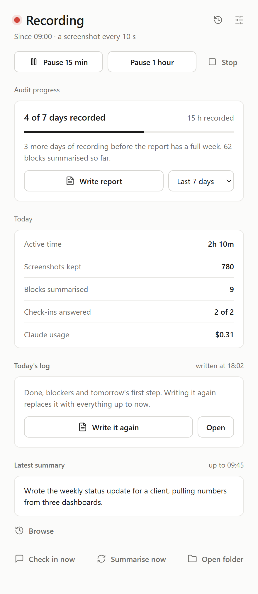
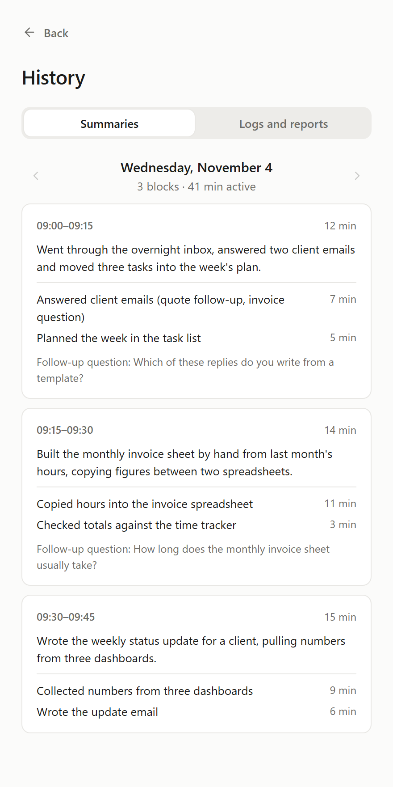
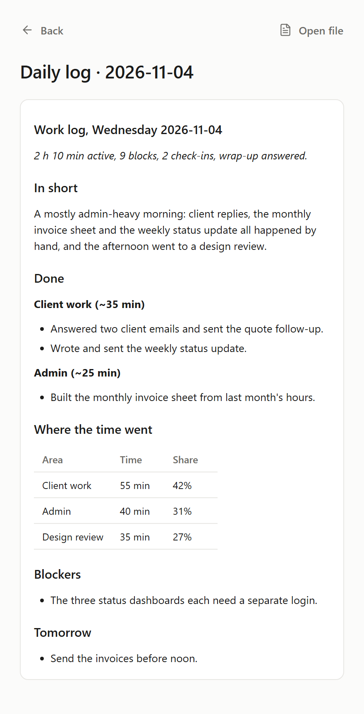

# Screen Audit for Mac

Find out which of your work could be automated. Screen Audit records what
you actually do for a week: a screenshot every few seconds, a short AI
summary of every 15 minutes, and a few quick "what are you doing and why?"
check-ins a day. At the end it turns all of that into a list of your
recurring tasks, each with a verdict on whether it's worth automating and
how.

Everything stays on your Mac, apart from what goes to your own Claude or
ChatGPT account to write the summaries.

<p align="center">
  
  
  
</p>

<sub>The window, the History page and a daily log. The pictures use made-up sample data.</sub>

## Install

Tell your AI assistant (Claude Code or Codex):

> Set up Screen Audit for me: https://github.com/alex-kosma/screen-audit-mac

It downloads Screen Audit, installs it, checks every step, and tells you
the few things only you can do: log in, and click Allow in System
Settings. You need Claude Code on a Claude plan, or Codex on a ChatGPT
plan; it uses the same one for the summaries.

**If you're an AI assistant:** follow [AGENTS.md](AGENTS.md)
(https://raw.githubusercontent.com/alex-kosma/screen-audit-mac/main/AGENTS.md).

## Setting it up by hand

You do this once. It takes about 15 minutes. Everything below that is in a
grey box gets typed (or pasted) into **Terminal**: press Cmd+Space, type
`Terminal`, press Return. Paste one line at a time and press Return after
each.

**The doctor** checks the whole setup and says how to fix anything that's
wrong:

```bash
python3 screen_audit.py doctor --try
```

`--try` also plays the pause and resume tones and shows a test
notification, so you can check that you hear and see them.

### 1. Install Python

Download Python 3.12 or newer from https://www.python.org/downloads/macos/
and run the installer. Then check it worked:

```bash
python3 --version
```

It should print `Python 3.12` or higher. (If macOS offers to install
"command line developer tools" instead, say yes, wait for it to finish, and
install Python from the link above anyway.)

### 2. Put the Screen Audit folder somewhere permanent

Download it (on https://github.com/alex-kosma/screen-audit-mac: **Code**, **Download ZIP**), unzip it, and move the
folder to your home folder as `~/screen-audit-mac`. The
app runs from this folder, so don't move or rename it later. (If you do,
repeat step 5.)

### 3. Install what Screen Audit needs

```bash
cd ~/screen-audit-mac
```

```bash
python3 -m pip install -r requirements.txt
```

If that says "externally-managed-environment" (it happens with Homebrew's
Python), make a private environment for it instead and use its Python from
now on:

```bash
python3 -m venv .venv
```

```bash
.venv/bin/python -m pip install -r requirements.txt
```

Then type `.venv/bin/python` wherever these steps say `python3`.

### 4. Install Claude Code and log in

Screen Audit sends the screenshots to Claude through your own Claude Code
login, so the summaries count toward your Claude plan.

```bash
curl -fsSL https://claude.ai/install.sh | bash
```

Close Terminal, open it again, then:

```bash
claude
```

Follow the login steps, then type `/exit`. If Screen Audit later says it
can't find `claude`, run `which claude`, copy the path it prints, and put it
in `config.json` as `"claude_path": "/the/path/it/printed"`.

**No Claude plan, but ChatGPT?** Screen Audit can use Codex, OpenAI's
equivalent, instead. Skip the Claude steps above and run:

```bash
curl -fsSL https://chatgpt.com/codex/install.sh | sh
```

Close Terminal, open it again, then:

```bash
codex
```

Choose **Sign in with ChatGPT** (it needs a Plus, Pro or Business plan), or
use an OpenAI API key, then quit with Ctrl+C. Once the app is open (step 6),
go to Settings, AI, and choose **Codex (ChatGPT)**. If Screen Audit can't
find `codex`, put the path `which codex` prints in `config.json` as
`"codex_path"`.

### 5. Make the app

```bash
cd ~/screen-audit-mac
```

```bash
python3 make_icon.py
```

This draws the icon and makes **Screen Audit** in the Applications folder
of your home folder (`~/Applications`). Open it from Launchpad, Spotlight
(Cmd+Space, "Screen Audit") or Finder. To keep it handy, right-click its
Dock icon while it's open and choose Options, Keep in Dock.

### 6. Allow the two permissions

The first time, the window shows a **Before you start: two permissions**
panel.

- **Screen Recording** (required). Without it macOS hands every screenshot
  back as just the desktop picture, so nothing useful is saved.
- **Accessibility** (recommended). Lets Screen Audit read the title of the
  window in front, which some apps don't give to Screen Recording.

Press **Open System Settings** next to each, switch on **Screen Audit** in
the list (use the + button to add it from `~/Applications` if it isn't
there), then quit Screen Audit with Cmd+Q and open it again. macOS only
applies Screen Recording to an app after it restarts. The panel goes away
once both are allowed. Accessibility can be skipped with **Hide this**.

If you started Screen Audit from Terminal instead of the app, macOS asks
about **Terminal** rather than Screen Audit; switch that on instead.

Newer macOS versions also ask now and then whether Screen Audit may keep
recording the screen. Answer Allow, or recording stops saving.

## Using it

Open **Screen Audit**. One window. If Claude Code isn't installed or logged
in (or Codex, if that's chosen), a **Claude isn't connected** panel at the top says so and walks through
step 4 above, with a Copy button for the install line and **Check again**
to test it (a one-word question to Haiku, a fraction of a cent). Recording
works without Claude, but nothing gets summarised, no daily log or report
can be written, and screenshots are never deleted, because they're only
cleaned up once summarised.

- **Start recording.** Recording runs as its own background process, so
  closing the window doesn't stop it.
- **Menu bar icon, while recording.** The little character with a red
  antenna light, at the top right of the screen. While paused, the light
  turns amber and its eyes close. Click it for Open Screen Audit, Pause 15
  min, Pause 1 hour, Resume and Stop recording. No icon means not
  recording. (A full menu bar can hide icons behind the notch on a laptop;
  quit another menu bar app if you can't see it.)
- **Pause 15 min / Pause 1 hour / Resume / Stop.** Pause before banking,
  health, or anything about other people you wouldn't paste into a chat.
  Stopping keeps everything recorded so far and clears any pause.
- **Audit progress:** days recorded out of the audit length (7 by default)
  and total hours. *Write report* becomes the main button once the audit
  length is reached. It summarises anything left, has Opus write the report
  (a few minutes), then opens it.
- **Today:** active time, screenshots kept, blocks summarised, check-ins
  answered, Claude usage, and the latest 15-minute summary.
- **Today's log:** *Write today's log* opens the wrap-up questions (unless
  they're off or already answered), then writes `reports/daily/<date>.md`
  with Sonnet in about a minute and opens it: in short, what got done per
  project, where the time went, blockers, open loops, and tomorrow. Writing
  it again replaces it with everything up to now. The same happens on its own
  at the wrap-up time.
- **History** (clock icon, top right, or *Browse* under the latest summary):
  *Summaries* steps through the days, newest first, and lists each day's
  15-minute blocks with what was done and the follow-up question. *Logs and
  reports* lists every daily log and report, opens one to read in the window,
  and *Open file* opens it in your editor. Esc goes back.
- **Check in now / Summarise now / Open folder** (the `data` folder).
- **Storage** (in Settings): how much space screenshots, logs and summaries,
  and reports take, the free space on that disk, how many days of
  screenshots there are, and how many are past the keep setting but still
  waiting to be summarised. *Open screenshots folder* opens it in Finder.
- **Settings** (sliders icon, top right): where screenshots are saved,
  screenshot interval, how long to keep screenshots, *Start recording when
  you log in*, check-ins per day (0 = off), the end-of-day wrap-up (on or
  off, and its time), audit length, language (English or Ukrainian), the
  privacy word list, and the "already automated" list the report reads.
  Saving restarts a running recording so the changes apply.

Follows the Mac's light or dark appearance. On first launch the language
follows the first language in System Settings, General, Language & Region
(Ukrainian if that is Ukrainian, otherwise English) and is saved to
`config.json`; change it in Settings. It covers the window, popups and menu
bar icon, and the language Claude writes summaries, follow-up questions,
daily logs and the report in. Process names inside the 15-minute summaries
stay English so days stay comparable. Pause, resume and stop work from the
window, the menu bar and the check-in popup alike, and each shows the
others' changes within a couple of seconds.

Reports and logs are Markdown files. They open in whatever app your Mac
uses for `.md` files, or TextEdit if none is set.

## What happens underneath

| Piece | When | What |
|---|---|---|
| Capture | every 5 s | Screenshot of the display the active window is on, at the display's full resolution (2x on a Retina screen; JPEG quality 85, no chroma subsampling, so text stays readable), plus window title and app. Other displays are saved separately when they change. Unchanged screens aren't saved twice. Skipped while idle (2 min), paused, locked, without Screen Recording permission, or when the window title or app is on the privacy list |
| Summarise | every 15 min | Up to 6 screenshots plus the window timeline go to Claude Haiku through your `claude` login. Back come the activities, the recurring process each belongs to, tools used and one follow-up question. About $0.02 to 0.04 a block in usage terms, roughly $1 a working day. Blocks with under a minute of activity are skipped. A failed block is retried on the next run |
| Check-in | ~8 a day, 9:00 to 22:00 | Small popup (same design as the window), bottom right of the screen you're on, asking Claude's follow-up question or a generic one, with an optional *Anything blocking you?* field. Cmd+Enter saves, Esc skips. "Pause 1 hour" does what it says. Closes itself after 5 minutes if nothing's typed. Not shown while idle or paused |
| Wrap-up | once a day, from 18:30 | Popup in the middle of the screen with three optional questions: what you finished that the screen wouldn't show, what blocked you, the first thing tomorrow. Shows the blockers you noted in check-ins that day. Appears the first moment you're at the keyboard after the wrap-up time, only on days with 30+ active minutes. *Write today's log* (Cmd+Enter) or left untouched for 15 min: the log is written. *Not today* (Esc): no log |
| Daily log | after the wrap-up, or on demand | Sonnet reads the day's block summaries, check-in answers and blockers, the wrap-up, and yesterday's "first thing tomorrow" (and says whether it happened). Writes `reports/daily/<date>.md`. About 30 s and a few cents |
| Cleanup | hourly | Deletes screenshot day-folders older than the keep setting, but only once they've been summarised |
| Report | on demand | Opus reads the block summaries, your answers and time per app, plus `context.md`. Writes `reports/report-<date>.md` with sections: where the time went, the task inventory, a verdict per task (schedule it / skill with review / keep human), the five to build first, and open questions |

*Start recording when you log in* adds
`~/Library/LaunchAgents/com.screenaudit.recorder.plist`. From the next
login it starts the recorder (with its menu bar icon), not the window.
Switching it off removes the file.

## Settings reference

The window covers the everyday ones. Everything else goes in `config.json`
next to the scripts (created on first launch). A key there overrides the
default at the top of `screen_audit.py`. Once Settings has been saved,
`config.json` pins the privacy list too, so a new default word added to the
code won't reach you; add it in Settings instead.

| Key | Default | In the window | Meaning |
|---|---|---|---|
| `interval_sec` | 5 | yes | Seconds between screenshots |
| `keep_frames_days` | 3 | yes | Days to keep screenshots (only once summarised) |
| `frames_location` | empty | yes | Folder for screenshots; see below. Empty = `data/frames` |
| `checkin_per_day` | 8 | yes | Check-in popups a day; 0 turns them off |
| `wrapup_enabled` / `wrapup_time` | true / "18:30" | yes | End-of-day wrap-up popup and automatic daily log |
| `wrapup_min_active_min` | 30 | no | No wrap-up on days with less active time than this |
| `daily_model` | sonnet | no | Model for the daily log |
| `audit_days` | 7 | yes | Days the progress bar counts toward |
| `language` | from macOS on first launch | yes | `en` or `uk` |
| `exclude_title_keywords` | password managers, private browsing, banks, sign-in pages | yes | No screenshot while the window title contains one (case ignored) |
| `exclude_processes` | Keychain Access, Passwords, 1Password, Bitwarden, KeePassXC, Strongbox | no | No screenshot while one of these apps is in front. Use the name shown in the menu bar next to the Apple menu |
| `exclude_bundle_ids` | the same apps by bundle id (`com.apple.Passwords`, `com.apple.keychainaccess`, ...) | no | The same as above, but by an id that doesn't change with the Mac's language. macOS translates its own apps' names, so this is what catches Passwords and Keychain Access on a Mac that isn't in English |
| `claude_path` | empty | no | Full path to `claude` if Screen Audit can't find it |
| `ai` | claude | yes | `claude` or `codex`: who writes the summaries, daily logs and report |
| `codex_path` | empty | no | Full path to `codex` if Screen Audit can't find it |
| `codex_models` | `gpt-6-luna` for summaries, Codex's default for the daily log and report | no | Codex model per job (`analysis`, `daily`, `report`); empty uses Codex's default. Set only the jobs you want to change, e.g. `{"report": "gpt-6-astra"}` |
| `codex_effort` | low / medium / high | no | How hard Codex thinks for summaries, daily logs and the report; set only the jobs you want to change |
| `data_dir` | `data` next to the scripts | no | Logs, summaries, state |
| `max_width` | 0 | no | Shrink screenshots to this width; 0 = full resolution |
| `jpeg_quality` / `jpeg_subsampling` | 85 / 0 | no | Screenshot quality; 0 subsampling keeps coloured text sharp |
| `dedupe_threshold` | 1.5 | no | How different a screen must be (0 to 255) to be saved again |
| `idle_skip_sec` | 120 | no | No keyboard or mouse for this long = idle, nothing saved |
| `batch_minutes` / `frames_per_batch` | 15 / 6 | no | Summary block length, and screenshots sent per block |
| `analysis_model` / `report_model` | haiku / opus | no | Models for summaries and for the report |
| `checkin_min_gap_min` | 45 | no | Minimum minutes between check-ins (random up to ~2.2x) |
| `checkin_hours` | [9, 22] | no | Hours check-ins can appear |
| `checkin_timeout_min` | 5 | no | An untouched check-in closes after this many minutes |

**Screenshots elsewhere** (*Save screenshots in*, or `frames_location`):
the app creates a `Screen Audit frames` folder inside the folder you pick
and only ever cleans inside it, so it can't touch your own date-named
folders. Each frame is logged with its full path, so changing the folder
later leaves earlier screenshots where they are and still readable. Cleanup
covers the current folder and the default one. An external drive works;
recording into it fails (and shows a red alert) while it's unplugged.

## Files

| File | What |
|---|---|
| `screen_audit_checkin.py` + `checkin.html`, `wrapup.html` | The check-in and wrap-up popups, same style. `tokens.css`, `components.css` and `icons.js` are the shared design kit |
| `screen_audit_gui.py` + `ui.html` | The window: an HTML page in a native window via pywebview. `python3 screen_audit_gui.py --debug` opens it with the web inspector |
| `screen_audit.py` | The engine and the menu bar icon. Commands: `run [--no-tray]`, `analyze`, `checkin`, `wrapup`, `daily [--date YYYY-MM-DD] [--no-open]`, `report [--days 7] [--model opus]`, `pause [minutes]` (0 = until resume), `resume`, `status` |
| `macos.py` | Everything that talks to macOS: idle time, the app and window in front, displays, screenshots (`screencapture`), permissions, appearance, language, opening files, background processes, the login item |
| `make_icon.py`, `screen_audit.icns`, `screen_audit.png` | The character icon (drawer, Mac icon, 256 px preview). `python3 make_icon.py` also rebuilds `~/Applications/Screen Audit.app` |
| `tests/test_logic.py` | Checks that run anywhere: `python3 -m unittest discover tests` |
| `DESIGN_RULES.md` | The window's type, colour, button and wording rules |
| `context.md` | What's already automated, so the report doesn't recommend building it again. Keep it current. Made from `context.example.md` the first time; it's yours, so git leaves it out |
| `config.json` | Your settings (see above); created on first launch with the detected language |
| `i18n.js` | Every word on the pages in English and Ukrainian. The menu bar and written files use `TEXT` in `screen_audit.py` |
| `requirements.txt` | pillow, pystray, pywebview, and the pyobjc parts for macOS |
| `reports/` | Generated reports. They describe your whole day, personal parts included. Keep them private |
| `data/` | Everything recorded (below) |

`Screen Audit.app` is a small shell script in a bundle: it runs
`screen_audit_gui.py` (or, with `record`, the recorder) with the Python that
ran `make_icon.py`, from this folder.

Inside `data/`:

| Path | What |
|---|---|
| `activity/<day>.jsonl` | One line per tick: time, state (`frame`, `same`, `idle`, `paused`, `locked`, `excluded`, `no_permission`), window title, app, frame path |
| `frames/<day>/<time>.jpg` | Screenshots, unless *Save screenshots in* points elsewhere |
| `analysis/<day>.jsonl` | One summary per 15-minute block, with its cost |
| `checkins/<day>.jsonl` | Check-in questions, your answers and blockers |
| `wrapups/<day>.json` | The end-of-day answers (finished, blockers, tomorrow) |
| `errors.jsonl` | Anything that went wrong; the window shows the last hour's |
| `background.log` | What the background processes printed |
| `state.json` | Recorder PID and start time, how far summaries have got |
| `paused_until` | Exists while paused ("forever" or an end time) |
| `stop_request`, `show_request` | Briefly exist when the window asks the recorder to stop, or a second launch asks the window to come forward |
| `run.lock`, `gui.lock` | Stop a second recorder or window from starting |

## Disk

A Retina frame is roughly 0.5 to 1.2 MB. With unchanged screens skipped,
expect about 1 to 2 GB per working day, so about 3 to 6 GB at the default
3-day retention. To halve that, set the screenshot interval to 10 s in
Settings. The Settings page shows the free space where screenshots go and
warns under 10 GB.

## Privacy

Screenshots go to Anthropic through the same login as every other Claude
Code call, or to OpenAI through your Codex login when Settings, AI is set to
Codex.

Either way the AI only gets the prompt and the screenshots. Claude runs
with no tools except reading the screenshots. Codex runs read-only, with
shell commands, file reading, web search, browser and computer control,
plugins, connected apps and hooks switched off, and without your own Codex
settings, rules or project `AGENTS.md` files. One thing Codex still reads
is a personal `~/.codex/AGENTS.md`, if you have one; keep it free of
instructions that would change how it answers here. The privacy lists only match window titles and app names, so
they only catch what names itself. The summary prompt asks Claude to
describe messages generically; that's a request, not a guarantee.

Neither keeps a copy. Claude runs without saving the session (otherwise
every screenshot would also end up in `~/.claude/projects`) and without
your settings or any `CLAUDE.md`, so your own instructions don't go along
with the screenshots. Codex runs `--ephemeral`.

Whether Anthropic or OpenAI may train on what's sent is your account's
setting, not Screen Audit's. Check it before you start: in Claude,
Settings, Privacy, *Help improve Claude*; in ChatGPT, Settings, Data
controls, *Improve the model for everyone*.

## Troubleshooting

Start with `python3 screen_audit.py doctor`. It checks everything below
and prints a fix for anything that fails.

- **No alert when summaries fail:** System Settings, Notifications,
  Script Editor: allow notifications. macOS files Screen Audit's banners
  under Script Editor.
- **A red alert in the window:** an error from the last hour. The full list
  is in `data/errors.jsonl`; `data/background.log` has the rest.
- **"(permission) Screen Recording is not allowed":** System Settings,
  Privacy & Security, Screen & System Audio Recording: switch on Screen
  Audit (or Terminal, or Python, whichever started it). Then quit Screen
  Audit, open it again, and Stop and Start recording.
- **Screenshots show only the desktop picture:** same as above.
- **Claude works in Terminal but summaries fail with "node: No such file or directory":**
  Claude was installed with npm and its Node isn't in one of the usual
  places. Set `claude_path` to the full path `which claude` prints; Screen
  Audit then also looks for `node` in that same folder.
- **Window titles are empty in the summaries:** allow Accessibility, then
  restart recording.
- **No menu bar icon while the window says Recording:** on a laptop it may
  be hidden behind the notch. If it really is missing, `errors.jsonl` will
  have a `tray` entry; recording carries on without it.
- **Claude works in Terminal but not in Screen Audit, and you sign in
  through `apiKeyHelper` or `env` in Claude's settings.json:** summaries
  run without your Claude settings. Log in with `claude` instead, or set
  `ANTHROPIC_API_KEY` for the app.
- **Summaries stopped, or "claude CLI not found":** check `claude` still
  works in Terminal (login expired?). If it works there but not in the app,
  set `claude_path` (step 4). Failed blocks retry on the next run, or press
  *Summarise now*.
- **Stop does nothing:** the window asks the recorder to stop and ends it
  after 3 seconds if it hasn't.
- **Moved the folder or reinstalled Python:** run `python3 make_icon.py`
  again, and switch *Start recording when you log in* off and on.
- **Command line:** `python3 screen_audit.py status` prints the same numbers
  as the window. `stop` and `restart` do what the menu bar items do.

## Backup

Keep `data/`, `reports/` and `config.json` out of git and out of anything
shared; they're personal. `.gitignore` already leaves them out.

## Checking it on a real Mac

What a machine can check runs on every push: `tests/test_logic.py` on the
logic, and `tests/mac_smoke.py` on GitHub's macOS 14 and 15 computers. It
starts, restarts and stops the recorder from the command line, runs the
doctor, and calls the real macOS pieces. Those computers have no speakers,
no one to click Allow, and no one to look at the screen, so this
five-minute pass needs a person on a real Mac:

1. `python3 screen_audit.py doctor --try`: no FAIL, you heard a falling
   then a rising tone, and a "Screen Audit: test" banner appeared.
2. Menu bar icon, **Pause 15 min**: falling tone, amber icon with closed
   eyes. **Resume**: rising tone, red icon.
3. Pause from the window, then resume from the window: the same tones.
4. **Restart**: the icon goes and comes back within a few seconds, still
   recording (`python3 screen_audit.py status`).
5. **Exit (stops recording)**: the icon goes, and the window shows
   Stopped.
6. Failure alert: in Terminal run `claude auth logout` (or `codex logout`)
   and keep recording. The next 15-minute summary fails, and a "summaries
   are failing" banner appears within a minute of that. Log in again
   afterwards and press **Summarise now**. The failed block is retried.
7. With Ukrainian chosen in Settings, the menu and the banner are in
   Ukrainian.
